# 星渡 · 8.3.0（22）

已向原内部 TestFlight 测试员开放，可在 TestFlight 更新。

- 战斗显示头像、等级、本局金币，可暂停和退出，保留已经拾取的资源。
- 20 位角色新增 40 套职业主题衣装，立绘、战斗背面和头像同步换装，原有拥有关系保留。
- 角色、武器、衣装分成三个招募池，加入可跳过的独立星轨特效和清楚的结果反馈。

以下是原生模拟器截图和实录。手机游玩请使用 TestFlight。

## 实际操作录像

[下载 32 秒操作实录（无声，MP4）](https://raw.githubusercontent.com/wisonlin/chain-reaction-demo/7a18b999229b96aceae5b396c83b5ff90557a9e0/native-83-demo.mp4)

## 实际界面

### 战斗：头像、等级、本局金币与生命条

[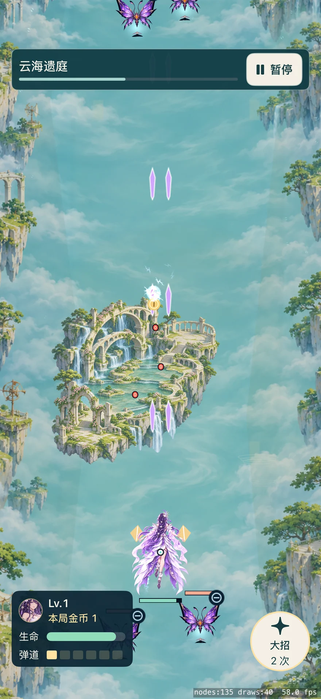](https://raw.githubusercontent.com/wisonlin/chain-reaction-demo/7a18b999229b96aceae5b396c83b5ff90557a9e0/native-83-hud.webp)

### 暂停和退出确认

[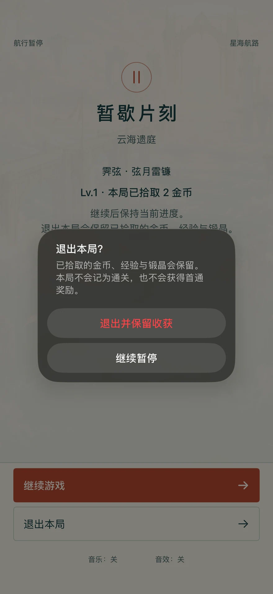](https://raw.githubusercontent.com/wisonlin/chain-reaction-demo/7a18b999229b96aceae5b396c83b5ff90557a9e0/native-83-pause.webp)

### 三个招募奖池与当前池入口

[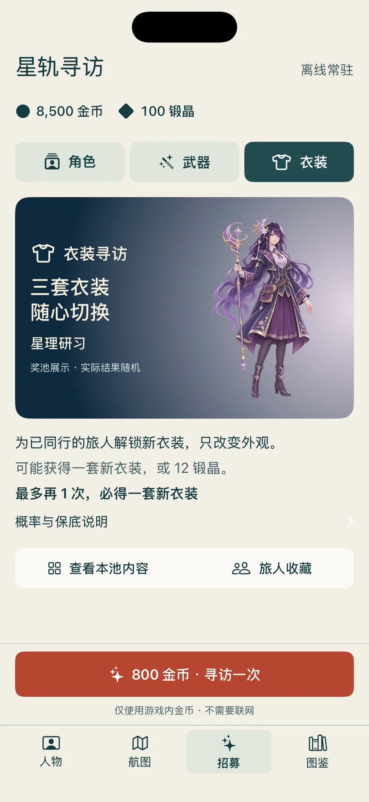](https://raw.githubusercontent.com/wisonlin/chain-reaction-demo/7a18b999229b96aceae5b396c83b5ff90557a9e0/native-83-recruit.webp)

### 独立原生星轨招募特效

[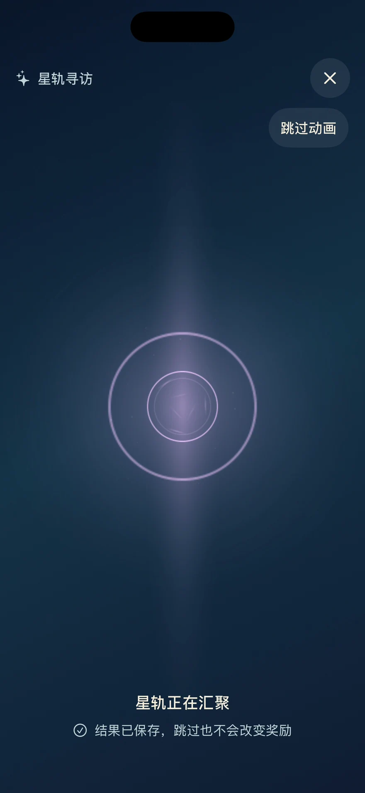](https://raw.githubusercontent.com/wisonlin/chain-reaction-demo/7a18b999229b96aceae5b396c83b5ff90557a9e0/native-83-ceremony.webp)

### 真实招募结果和金币变化

[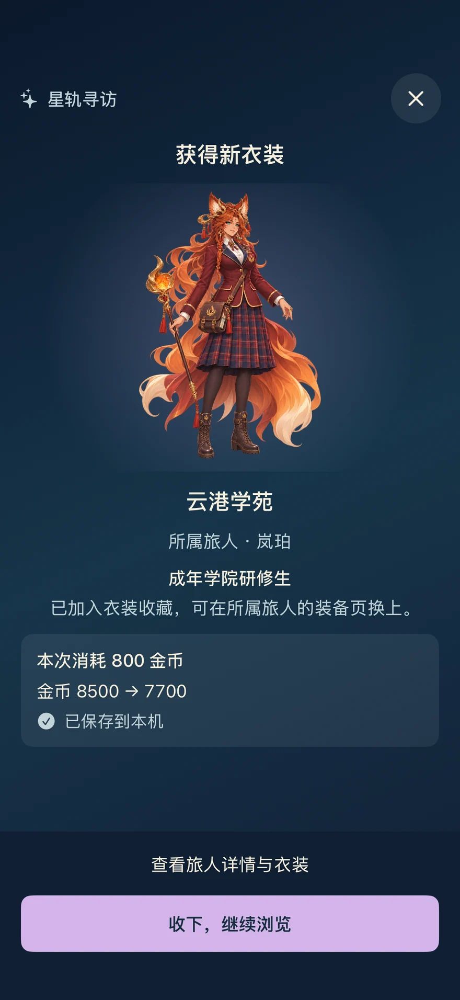](https://raw.githubusercontent.com/wisonlin/chain-reaction-demo/7a18b999229b96aceae5b396c83b5ff90557a9e0/native-83-result.webp)

### 职业衣装预览与换装

[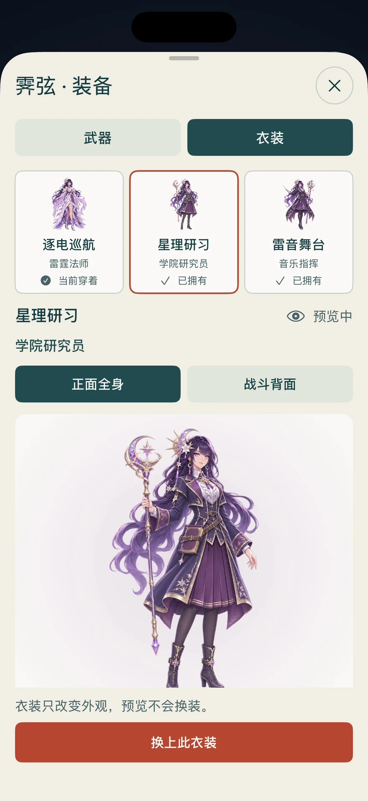](https://raw.githubusercontent.com/wisonlin/chain-reaction-demo/7a18b999229b96aceae5b396c83b5ff90557a9e0/native-83-wardrobe.webp)

## 全部职业衣装

每张图有四位角色，各展示默认衣装和两套职业主题新衣装的正背面。点击图片可放大。未拥有的衣装仍需在游戏中获得。

[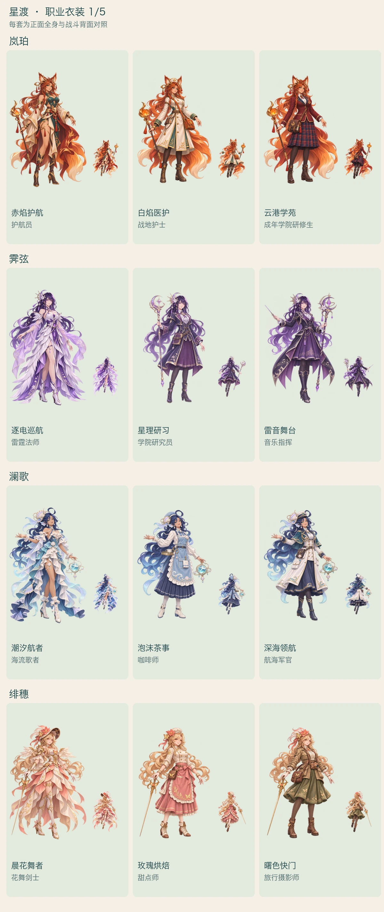](https://raw.githubusercontent.com/wisonlin/chain-reaction-demo/7a18b999229b96aceae5b396c83b5ff90557a9e0/native-83-outfits-1.webp)

[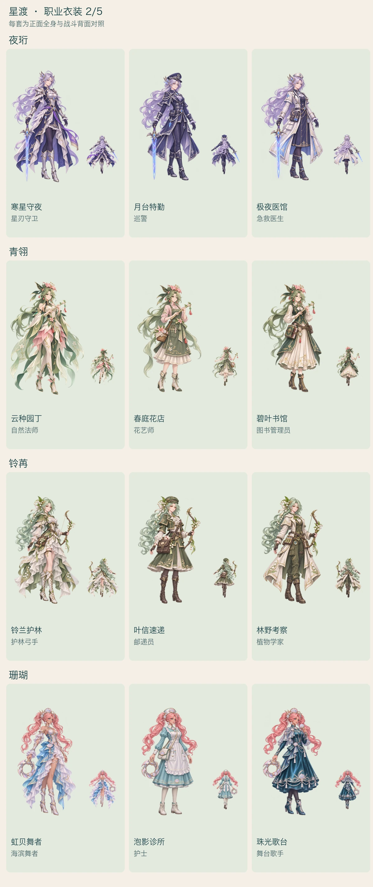](https://raw.githubusercontent.com/wisonlin/chain-reaction-demo/7a18b999229b96aceae5b396c83b5ff90557a9e0/native-83-outfits-2.webp)

[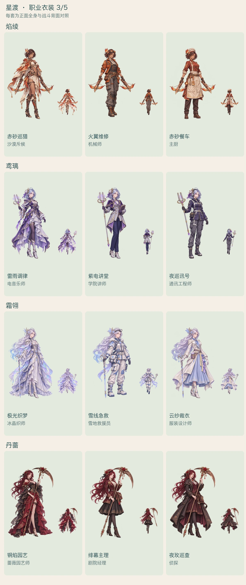](https://raw.githubusercontent.com/wisonlin/chain-reaction-demo/7a18b999229b96aceae5b396c83b5ff90557a9e0/native-83-outfits-3.webp)

[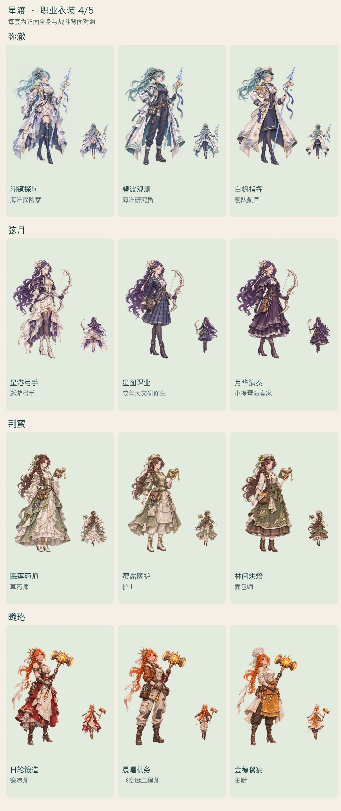](https://raw.githubusercontent.com/wisonlin/chain-reaction-demo/7a18b999229b96aceae5b396c83b5ff90557a9e0/native-83-outfits-4.webp)

[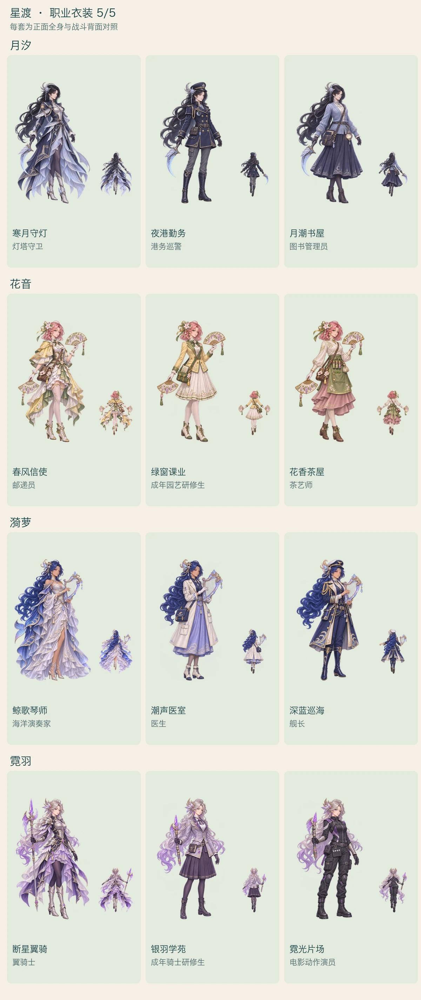](https://raw.githubusercontent.com/wisonlin/chain-reaction-demo/7a18b999229b96aceae5b396c83b5ff90557a9e0/native-83-outfits-5.webp)

